Fork of [marcreichel/laya-router](https://github.com/marcreichel/laya-router).

`laya-router` picks a model for each Claude Code session from its first prompt. Decision providers are pluggable: hosted [SubQ](https://subq.ai) is the default, and self-hosted laya-serve, Claude, and OpenAI-compatible endpoints are also supported.

| Request type | Model | Default effort |
|---|---|---|
| Quick question, translation, rename, typo, version bump | `claude-haiku-5-5` | low |
| Feature, refactor, tests, script, query, email, summary | `claude-sonnet-5-5` | medium |
| Subtle bug, flaky test, performance issue, architecture, migration, security audit | `claude-opus-5-5` | high |
| New theory, hypothesis, formal proof, mathematical bound | `claude-fable-5-1` (opt-in; otherwise Opus) | xhigh |

## Install and configure

In Claude Code:

```text
/plugin marketplace add eagskunst/laya-router
/plugin install laya-router@laya-router
```

Open `/config`, choose a **Decision provider**, and paste its key into **Decider API key**:

- **SubQ** (default): hosted decision service; requires a SubQ API key.
- **laya**: self-hosted `laya-serve`, optional key. Start it with this repo's `compose.yaml`:
  ```bash
  docker compose up -d --wait
  ```
- **claude**: uses Claude Code's `$.model.complete`; no separate key is needed.
- **openai-compatible**: requires an API key and a `deciderModel`; defaults to OpenRouter's API base URL.

`baseUrl` and `deciderModel` override provider defaults. `minConfidence: 0` uses the provider default (0.475 for SubQ/laya, 0.6 for Claude/OpenAI-compatible; SubQ/laya uses 0.375 with Fable enabled). `holdoutPercent` leaves that share of confident decisions on the session's `/model` for comparison.

Fable is opt-in with `enableFable`. Set per-tier efforts with `haikuEffort`, `sonnetEffort`, `opusEffort`, and `fableEffort`; Claude Code lowers an effort level that a model doesn't support.

Routing happens only on the first prompt. Prompts under three words remain on `/model`. Skill invocations use expanded skill text when the hook is available, otherwise their typed command. Subagents are not routed or measured. A manual `/model` change disables routing for the rest of the session.

## Measuring gains and losses

Each completed session stores a compact record: provider, route/group, model, confidence, turn and abort counts, override/feedback flags, token totals, and estimated costs. **Prompt text is never stored.** Records are retained in the plugin store, capped at 500 sessions.

- `holdoutPercent` randomly assigns confident sessions to a holdout group that stays on `/model`, while recording the tier the router would have selected.
- `/router-stats [days]` summarizes routed, holdout, and unrouted sessions, estimated actual and baseline costs, savings, and tier distribution.
- `/router-bad` flags the current session's route for later analysis.
- `prices` accepts JSON per-MTok price overrides keyed by model-ID prefix, for example `{"claude-opus-5-5":{"input":4,"output":20,"cacheWrite":5,"cacheRead":0.2}}`.

Because routing happens on the first prompt, no prompt cache is lost; the costs are the decider call and possible quality regressions (overrides, aborts, flags, more turns than holdout).

Costs use built-in model prices unless overridden. Unknown model prices are reported as unpriced. Baseline is an estimate: it reprices the same observed tokens at the session's original `/model`; it does not model how a different model might have generated a different conversation. SubQ decision input is estimated at $0.05/MTok; laya decisions are free, while OpenAI-compatible decision costs are not estimated. Claude decider usage is priced with the configured model prices.

## Develop

```bash
claude plugin validate .
claude plugin test .
claude --plugin-dir .
node eval/route.ts   # score tier descriptions; ROUTER_URL, ROUTER_MODEL and ROUTER_API_KEY configure the endpoint
```

The eval script also accepts `LAYA_URL` as a fallback for `ROUTER_URL`. Re-run it after changing `hooks/tiers.ts`.
